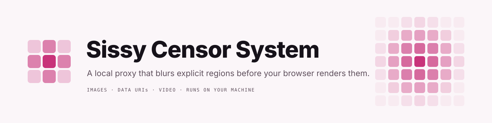

<picture>
  <source media="(prefers-color-scheme: dark)" srcset="docs/brand/banner-dark.svg">
  
</picture>

# Sissy Censor System

A local HTTP/HTTPS proxy that blurs female explicit regions in images before
the browser renders them. Male-labelled regions pass through untouched.
Images are always modified in place, never blocked or swapped for a
placeholder, so pages keep their layout and the rest of each picture stays
intact.

It runs as a single Docker container built on
[mitmproxy](https://mitmproxy.org/) and
[NudeNet](https://github.com/notAI-tech/NudeNet). Everything runs on your
machine: no external API calls, no telemetry.

## What it censors

- **Images**: JPEG, PNG, WebP and AVIF, plus animated GIF and WebP (frames
  are sampled, with boxes carried across the frames in between)
- **Data URIs**: base64 images inlined in HTML, CSS and JSON responses
- **Video**: every `<video>` on a page is paused and covered by an injected
  control. "Play censored" has the proxy fetch the video, blur it with
  ffmpeg and stream the censored copy back as it is produced.

Detection favours recall: a false positive (an unnecessary blur) is preferred
to a miss. If detection fails or times out, the whole image is censored.
Blur style (Gaussian, pixelate or solid fill), thresholds and almost every
other behaviour are configurable.

## Quick start

From `src/`:

```bash
docker compose up -d --build
```

The proxy listens on `127.0.0.1:8080` (loopback only). Check that it's up:

```bash
curl -x http://127.0.0.1:8080 http://censor.local/health
```

Then trust the CA that mitmproxy generated in `src/mitmproxy/` and point your
browser or system at the proxy. [`src/README.md`](src/README.md) has the
steps for the system store and Chromium, plus configuration, detection
review and tests.

## How it works

1. mitmproxy terminates TLS with its own CA and routes each response by
   Content-Type.
2. Image responses, and images found inside HTML, CSS and JSON bodies, go
   through one function, `Censor.censor_bytes()`, which decodes the image and
   runs NudeNet on it.
3. A single selection rule, `decide()`, picks the boxes to censor. Female
   labels are censored above context-dependent thresholds; labels that
   aren't sex-specific (buttocks, anus) are censored unless they sit near
   male context only.
4. The chosen boxes are padded, blurred and the image is re-encoded in its
   original format.
5. Every detection is written to a JSONL log for later tuning.

Two models ship in the image: the fast 320n (default, about 0.1 s per image
on CPU) and the more accurate 640m (about 0.6 s).

## Configuration

Edit [`src/config/config.yaml`](src/config/config.yaml) and restart the
container. It only needs the keys you change; every option and its default
is documented in
[`src/censor_proxy/defaults.yaml`](src/censor_proxy/defaults.yaml). Unknown
keys are rejected at startup.

## Security and privacy

- The proxy's CA can intercept all of your HTTPS traffic. Its private key
  lives in `src/mitmproxy/`: never commit or share it.
- The port is bound to loopback only. Don't expose it to your network.
- Whitelisted hosts bypass interception entirely: the built-in list covers
  browser and OS updates, sign-in, password managers, payments, banks,
  health sites, streaming services, .gov/.mil/.edu, gov.uk and edu.au; add
  your own from the
  admin panel's Whitelist tab (`whitelist.domains`).
- Video injection extends every page's Content-Security-Policy to allow the
  injected script, and lets pages ask the proxy to fetch public video URLs.
  Narrow `video.hosts` to limit this. Private and loopback addresses are
  refused unless `video.allow_private_sources` is on.
- The detection log records hostnames at the default `info` level, and full
  URLs at `debug`.

## Project status

Image and data-URI censoring are done and verified in Chromium. Video works
end to end but still needs checking in a real browser. A system-wide proxy
setup and Firefox support are still to do. See
[`docs/status.md`](docs/status.md) for the full list.

## Documentation

- [`src/README.md`](src/README.md): run, browser setup, configure, review,
  test
- [`docs/decisions.md`](docs/decisions.md): design decisions and detection
  tuning, with the reasoning behind each threshold
- [`docs/video-design.md`](docs/video-design.md): how video censoring works
- [`docs/status.md`](docs/status.md): what's done and what's next
- [`docs/brand/`](docs/brand/): the mark, README banners and palette
- [`docs/Image Censoring Proxy — Project Handoff.md`](<docs/Image Censoring Proxy — Project Handoff.md>):
  the original plan (historical)

## Layout

```
README.md               this file
docs/                   design docs, status, decisions
src/censor.py           mitmproxy addon (entry point)
src/censor_proxy/       detection, imaging, data URIs, video, config
src/config/config.yaml  your overrides
src/tests/              pytest suite and per-model fixtures
src/tools/              detection review tooling
```
